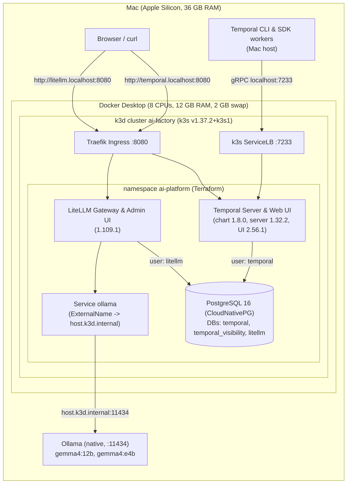

# Architecture

One command, `task up`, starts Ollama on the Mac, creates or resumes the local `k3d` Kubernetes cluster (`ai-factory`), applies the Terraform platform stack (`ai-platform`), and runs `task doctor` to verify every component end-to-end.

## Components and responsibilities

| Component | Where it runs | Pinned version | Role in the platform |
| --- | --- | --- | --- |
| **Ollama** | Native on macOS (`127.0.0.1:11434`) | `>= 0.40` (`0.40.16`) | Serves `gemma4:12b` and `gemma4:e4b` directly on Apple Silicon GPU/Metal (Docker containers on macOS cannot access the GPU). |
| **k3d / k3s** | Docker Desktop (`ai-factory`) | k3d `5.9.0`, k3s `v1.37.2+k3s1` | Certified single-server Kubernetes cluster that starts and stops in seconds while keeping persistent volumes intact. |
| **Traefik** | `kube-system` (`:8080`) | Bundled with k3s | Routes `http://litellm.localhost:8080` and `http://temporal.localhost:8080` over a single host port without `kubectl port-forward`. |
| **CloudNativePG & PostgreSQL** | `ai-platform` (`terraform/modules/postgres`) | Operator chart `0.29.1`, Cluster chart `0.9.0`, PostgreSQL `16` | Runs one shared PostgreSQL instance (`ai-postgres-cluster`) with three isolated databases (`temporal`, `temporal_visibility`, `litellm`) and strict `pg_hba` per-role isolation (`temporal` and `litellm` users). |
| **Model Backend Service** | `ai-platform` (`terraform/modules/model-backend`) | Kubernetes `Service/v1` | `ExternalName` Service named `ollama` pointing at `host.k3d.internal:11434`. Decouples LiteLLM from where the model server runs. |
| **LiteLLM** | `ai-platform` (`terraform/modules/litellm`) | Chart & image `1.109.1` | OpenAI-compatible model gateway and Admin UI (`/ui`). Maps `pm-agent` -> `gemma4:12b` and `dev-agent` / `sec-agent` -> `gemma4:e4b`, with one scoped virtual API key per agent. |
| **Temporal** | `ai-platform` (`terraform/modules/temporal`) | Chart `1.8.0` (server `1.32.2`, UI `2.56.1`) | Durable workflow orchestrator (`frontend`, `history`, `matching`, `worker`, `web`) backed by PostgreSQL persistence and SQL visibility. Exposes gRPC on `localhost:7233` to the Mac and the Web UI on `http://temporal.localhost:8080`. |

## Network and port map

| Host / In-cluster address | Protocol | Target | Purpose |
| --- | --- | --- | --- |
| `http://litellm.localhost:8080/v1` | HTTP | Traefik -> `svc/litellm:4000` | OpenAI-compatible chat completions API for agents |
| `http://litellm.localhost:8080/ui` | HTTP | Traefik -> `svc/litellm:4000` | LiteLLM Admin UI (`admin` + `litellm-masterkey`) |
| `http://temporal.localhost:8080` | HTTP | Traefik -> `svc/temporal-web:8080` | Temporal Web UI (workflows in `default` namespace) |
| `localhost:7233` | gRPC (h2c) | k3s ServiceLB -> `svc/temporal-frontend:7233` | Temporal frontend gRPC for the `temporal` CLI and SDK workers on the Mac |
| `http://127.0.0.1:11434` | HTTP | Native macOS Ollama process | Host Ollama API (`host.k3d.internal:11434` from inside pods) |
| `ai-postgres-cluster-rw.ai-platform.svc:5432` | TCP (PostgreSQL) | Primary PostgreSQL pod | In-cluster read-write database endpoint for LiteLLM and Temporal |

## Measured memory and CPU use

Measured on 16 Nov 2026 with `task status` (`docker stats --no-stream`, `kubectl top pods -n ai-platform`, and `ollama ps`) on the 36 GB Mac while the full stack was running and serving requests:

### 1. In-cluster pods (`namespace: ai-platform`)

| Pod / Component | Idle CPU | Measured Memory (RSS) | Plan Estimate | Notes |
| --- | --- | --- | --- | --- |
| `litellm` | `6m` | **697 MiB** | ~1,000 MiB | Python proxy + Prisma client + Admin UI |
| `temporal-history` | `24m` | **188 MiB** | — | 512 history shards on PostgreSQL |
| `temporal-matching` | `9m` | **63 MiB** | — | Task queue matching engine |
| `temporal-frontend` | `8m` | **56 MiB** | — | gRPC (`:7233`) & HTTP (`:7243`) frontend |
| `temporal-worker` | `6m` | **51 MiB** | — | Internal system workflows |
| `temporal-web` | `1m` | **32 MiB** | — | Web UI (`temporalio/ui:2.56.1`) |
| *Temporal subtotal (5 pods)* | *`48m`* | ***390 MiB*** | *~2,000 MiB* | SQL visibility avoids Elasticsearch overhead |
| `ai-postgres-cluster-1` | `10m` | **150 MiB** | — | PostgreSQL 16 (`shared_buffers = 128MB`) |
| `cnpg-cloudnative-pg` | `2m` | **36 MiB** | — | CloudNativePG operator |
| *PostgreSQL subtotal (2 pods)* | *`12m`* | ***186 MiB*** | *~800 MiB* | Shared server across 3 databases |

### 2. Whole-Mac memory budget (36 GB total)

| Consumer | Measured Memory | Ceiling / Budget | Detail |
| --- | --- | --- | --- |
| **k3d cluster (`k3d-ai-factory-server-0` + `serverlb`)** | **2.63 GiB** (`22.5%` of limit) | 12.0 GiB Docker Desktop ceiling | Includes k3s control plane, containerd, CoreDNS, Traefik, ServiceLB, PostgreSQL (`186 MiB`), LiteLLM (`697 MiB`), and Temporal (`390 MiB`). |
| **Ollama (idle, no models loaded)** | **~0.1 GiB** | — | Models unload automatically on `task down` or after idle timeout. |
| **Ollama (`gemma4:12b` loaded)** | **~8.9 GiB** | — | Used by `pm-agent`. |
| **Ollama (`gemma4:e4b` loaded)** | **~9.8 GiB** | — | Used by `dev-agent` and `sec-agent` (9.5 GB on disk). |
| **macOS, browser, IDE, Claude Code** | **~10.0 GiB** | — | Host OS and developer tools. |
| **Free headroom** | **~14.5 GiB** (1 model) / **~4.7 GiB** (both models) | — | Comfortable margin without swap pressure. |
