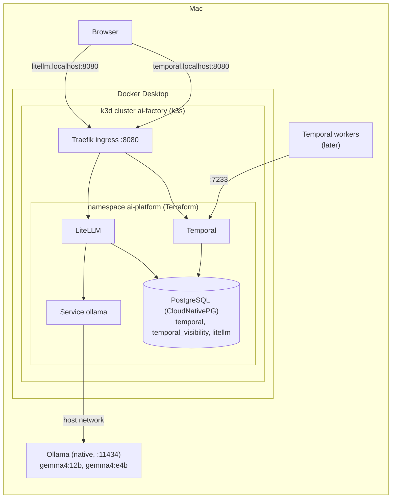

# Architecture

> Stub. Phase 6 completes this page with the measured memory use.

One command, `task up`, starts LiteLLM, Temporal and Ollama on the Mac. Terraform installs everything inside a k3d cluster; Ollama runs natively for the GPU.

LiteLLM never addresses the Mac directly: it calls the `ollama` Service. Moving the models elsewhere later means changing only that Service.
