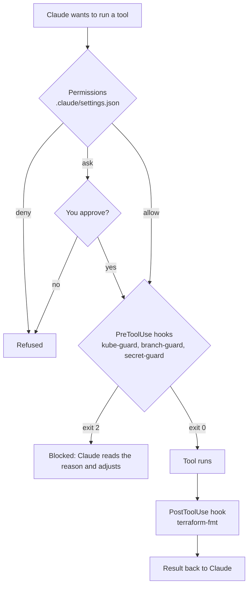

# The Claude Code harness

This repo ships a small setup that lets Claude Code work on it safely: rules it reads, permissions it cannot exceed, hooks that run whether or not it remembers (with tests), reusable procedures, two helper agents and one tool integration. Each file is short enough to read in a minute.

| Piece | File | What it does here | Claude Code docs |
| --- | --- | --- | --- |
| Rules | [CLAUDE.md](../CLAUDE.md) | Architecture, commands and the hard rules, loaded into every session | [Memory](https://code.claude.com/docs/en/memory) |
| Permissions | [.claude/settings.json](../.claude/settings.json) | Allow, ask and deny rules for tools and commands | [Settings and permissions](https://code.claude.com/docs/en/settings) |
| Hooks | [.claude/hooks/](../.claude/hooks/) | Scripts that run before or after a tool call | [Hooks](https://code.claude.com/docs/en/hooks) |
| Skills | [.claude/skills/](../.claude/skills/) | Step-by-step procedures Claude loads when a task matches | [Skills](https://code.claude.com/docs/en/skills) |
| Agents | [.claude/agents/](../.claude/agents/) | Helpers with their own instructions and a limited tool set | [Subagents](https://code.claude.com/docs/en/sub-agents) |
| MCP server | [.mcp.json](../.mcp.json) | A tool server that gives Claude current Terraform docs | [MCP](https://code.claude.com/docs/en/mcp) |

## What happens when Claude runs a tool

Every tool call (a shell command, a file edit) passes the same gates. Text rules shape what Claude tries; permissions and hooks decide what actually runs.



A `SessionStart` hook runs once before all of this and tells Claude which branch is checked out.

## Rules: CLAUDE.md

Claude reads `CLAUDE.md` at the start of every session in this repo. It holds what a new teammate would need on day one: the architecture in a few lines, the `task` commands, seven hard rules, the git workflow, and a short list of known behaviour on this Mac (found in phases 0 to 2) so Claude does not diagnose the same thing twice. The rules are the ones that matter most on this Mac: use only the project kubeconfig, change things only through Terraform, never read state or Secret values.

Rules in a text file depend on the model following them. The permissions and hooks below enforce the important ones regardless.

## Permissions: .claude/settings.json

Three lists, checked in this order: **deny** wins over **ask**, which wins over **allow**. Anything not listed asks.

- **Allow** (runs without a prompt): read-only and safe task commands (`task doctor`, `lint`, `ci`, `plan`, `status`, `down`), read-only `task kube -- get/describe/logs`, `terraform fmt`, `validate`, `init` and `plan`, read-only git (`status`, `diff`, `log`) and the hook tests.
- **Ask** (you confirm each time): anything that changes the cluster or the Mac. That covers `task up`, `apply` and `clean`, other `task kube` commands, `terraform apply` and `destroy`, `ollama pull` and `k3d`.
- **Deny** (never): reading `*.tfstate`, `*.tfvars`, `.env` files, any kubeconfig and Docker's `~/.docker/config.json`; `terraform state`, `show`, `output` and `console`; `kubectx`, `kubens` and `kubectl config use-context`.

Personal overrides go in `.claude/settings.local.json`, which is gitignored.

## Hooks: .claude/hooks/

A hook is a script Claude Code runs on every matching tool call. A `PreToolUse` hook that exits with code 2 blocks the call, and Claude sees the reason on stderr and adjusts.

| Hook | When | What it does |
| --- | --- | --- |
| `kube-guard.py` | Before every shell command | Blocks kubectl, helm or k9s unless they use this repo's `.kube/config`, and any context other than `k3d-ai-factory`. Blocks kubectx, kubens and `kubectl config` edits, provider overrides like `KUBE_CONFIG_PATH`, `terraform state/show/output/console`, `get secret -o ...`, and reading state, tfvars, `.env` or a kubeconfig with `cat`, `grep` and similar tools |
| `branch-guard.sh` | Before every shell command | Blocks `git commit` while main is checked out and `git push` to main. Added after the IDE switched this checkout to main in the middle of phase 1 |
| `secret-guard.sh` | Before every file write or edit | Pipes the new content through `gitleaks stdin` and blocks the write if it looks like a key, token or password |
| `terraform-fmt.sh` | After every file write or edit | Runs `terraform fmt` on an edited `.tf` or `.tfvars` file |
| `session-context.sh` | When a session starts | Prints the branch, the number of uncommitted files and whether the project kubeconfig exists. For `SessionStart`, what a hook prints becomes part of Claude's context |

The kube guard parses each part of a command line separately, so `echo hi && kubectl get ns` is still caught, and it also checks commands nested in `bash -c "..."`, `eval`, `$(...)` and backticks. No pattern matcher catches everything (a script file Claude writes and then runs is not inspected), which is why the deny rules and the project-only kubeconfig sit behind it. `task kube -- <args>` is the normal way in: `scripts/kube.sh` always passes the project kubeconfig and context.

Try one yourself. A hook reads the tool call as JSON on stdin, exactly as Claude Code sends it:

```bash
echo '{"tool_input":{"command":"kubectl get pods"}}' | CLAUDE_PROJECT_DIR=$PWD .claude/hooks/kube-guard.py; echo "exit $?"
```

`tests/hooks/run.sh` runs about 30 such cases (blocked and allowed) for kube-guard, branch-guard and secret-guard, and `task ci` runs it, so a hook cannot silently stop protecting you. When you change a hook, add a case for the new behaviour.

## Skills: .claude/skills/

A skill is a folder with a `SKILL.md`. Its `description` tells Claude when to use it; the body is the procedure. Claude loads the body only when a task matches, so skills cost nothing until used. You can also call one by name, for example `/debug-stack`.

| Skill | Use it when |
| --- | --- |
| `debug-stack` | `task doctor` or `task up` fails: read the failing pod's events and logs, name the cause, propose a fix |
| `add-model-route` | Changing which Ollama model an agent name uses, or adding an agent |
| `upgrade-version` | Bumping any pinned version: find the newest stable release, check compatibility, bump every pin, run the doctor |

## Agents: .claude/agents/

An agent (subagent) is a separate Claude with its own instructions and tool list. The main session hands it a job and gets back a short report, which keeps long log reading out of the main conversation. Both agents here are read-only by instruction, and the hooks and deny rules apply to them too.

| Agent | Job |
| --- | --- |
| `terraform-reviewer` | Reviews a Terraform change against the module conventions, pinned versions, provider 3.x syntax and the secret rules |
| `k8s-troubleshooter` | Diagnoses a failing pod with `task kube -- get/describe/logs` only |
| `version-security-auditor` | Audits pinned versions across Terraform, Helm charts, images and scripts against upstream stable releases, and checks secret/lockfile security posture |

## MCP server: .mcp.json

MCP (Model Context Protocol) lets Claude call tools in a separate server. This repo uses HashiCorp's open-source [Terraform MCP server](https://github.com/hashicorp/terraform-mcp-server), pinned to 1.4.1 by tag and digest like every other image, and run with Docker, with only its read-only `registry` toolset. It gives Claude the current docs for providers and modules, which matters because the Kubernetes and Helm providers 3.x are newer than most examples Claude has seen.

Claude Code asks you once to approve a server from `.mcp.json`; `enabledMcpjsonServers` in the settings pre-approves this one. It was tested on this Mac on 15 Nov 2026: it starts, lists nine registry tools and returns the latest Helm provider version.

There is deliberately no Kubernetes MCP server: `task kube` covers it, and a second path to clusters is a risk on a Mac with AKS contexts.

## Why there are not more skills and agents

Each skill or agent is text Claude may load and you have to maintain. Add one when the same multi-step procedure comes up a third time, or when a job produces a lot of output (logs, plans) that would crowd the main conversation. One-line rules belong in CLAUDE.md instead.

## Checks before commit

Not part of Claude Code, but part of the same safety net. `pre-commit install` (once per clone) makes every commit run `task ci -- --staged`: lint plus a gitleaks scan of the staged changes. GitHub Actions runs `task ci` on every pull request, scanning the whole history. A commit with a key in it is rejected before it exists.
