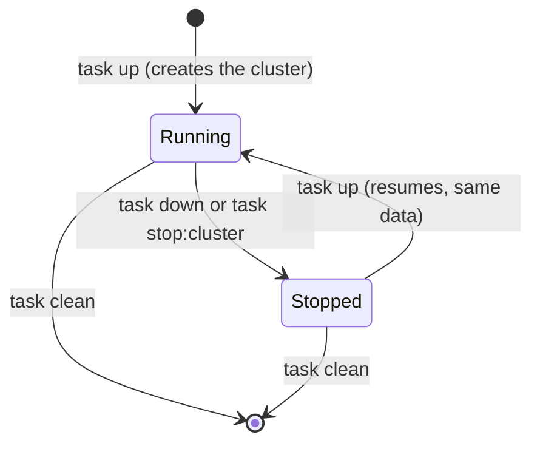

# Runbook

> Phases 3 to 6 add Terraform, the doctor and the rest of the commands as they land.

| Situation | Command |
| --- | --- |
| Check the Mac | `task doctor:prereqs` |
| Lint and secret scan | `task ci` |
| Start everything | `task up` |
| Stop, keep data | `task down` |
| Stop and start again | `task restart` |
| Stop only one part | `task stop:cluster` or `task stop:ollama` |
| See what runs | `task status` |
| Check the cluster | `task smoke:cluster` (add `-- --lifecycle` to also test down and up) |
| Look at the cluster | `task kube -- get pods -A` |
| Health check | `task doctor` (phase 6) |
| Start from scratch | `task clean` then `task up` |

## Cluster lifecycle



- `task up` is safe to repeat. It creates the cluster from `cluster/k3d-config.yaml` the first time, resumes it later, rewrites the project kubeconfig `.kube/config`, and waits until the node, CoreDNS, Traefik on port 8080 and the pod route to Ollama are ready. A fresh cluster takes about 50 seconds; a resume about 90, most of it waiting for CoreDNS to pick up `host.k3d.internal`.
- `task down` stops the cluster and unloads Ollama models. Volumes stay, so databases survive.
- `task clean` asks first, then deletes the cluster, `.kube/config` and the local Terraform state. Every database is lost.
- Every script hashes your own kubeconfig before and after k3d runs and fails if it changed. k3d is configured never to write it.

## A step times out

Each wait names what it waited for and the command that shows why. The common ones:

| Message mentions | Look at |
| --- | --- |
| the API server or the node | `task kube -- describe nodes`; Docker Desktop must be running with its memory limit |
| Traefik or port 8080 | `task kube -- -n kube-system get pods`; another process on 8080 (`lsof -nP -iTCP:8080`) |
| host.k3d.internal | `task kube -- -n kube-system logs deployment/coredns`; run `task up` again, it waits again |
| an image pull (`ErrImagePull`, `image access restricted`) | Docker Desktop signed in to an organization: sign out (`task doctor:prereqs` warns on `docker-signin`); see [registry access](prerequisites.md#registry-access) |

## Ollama pulls fail

`proxyconnect ... connection refused` means Ollama kept a proxy from when it started. Run `task stop:ollama`, then `task up`. `task doctor:prereqs` warns on `ollama-proxy`.

## Web UIs and API access

| Service | URL | Authentication |
| --- | --- | --- |
| LiteLLM Admin UI | `http://litellm.localhost:8080/ui` | Username: `admin`, Password: the `masterkey` value in Secret `litellm-masterkey` |
| LiteLLM OpenAI-compatible API | `http://litellm.localhost:8080/v1` | `Authorization: Bearer <key>` using an agent virtual key (`litellm-<agent>-key`) or the master key |
| LiteLLM Swagger / OpenAPI docs | `http://litellm.localhost:8080/` | Master key or virtual key in the Swagger **Authorize** dialog |
| Temporal Web UI (phase 5) | `http://temporal.localhost:8080` | None (local sandbox) |

### Log in to the LiteLLM Admin UI (`http://litellm.localhost:8080/ui`)

Because secrets are never stored in files or Terraform state, copy the master key straight from the cluster Secret into your macOS clipboard (nothing is printed to the terminal):

```bash
kubectl --kubeconfig .kube/config --context k3d-ai-factory \
  get secret litellm-masterkey -n ai-platform \
  -o jsonpath='{.data.masterkey}' | base64 -d | pbcopy
```

Then open `http://litellm.localhost:8080/ui` and sign in with:
- **Username:** `admin`
- **Password:** paste (`Cmd+V`)

### Call the LiteLLM API from your Mac

Each agent has its own scoped virtual key in Kubernetes (`litellm-pm-agent-key`, `litellm-dev-agent-key`, `litellm-sec-agent-key`). To send a chat completion from your terminal using an agent's virtual key:

```bash
AGENT="pm-agent" # or dev-agent, sec-agent
API_KEY="$(kubectl --kubeconfig .kube/config --context k3d-ai-factory \
  get secret "litellm-${AGENT}-key" -n ai-platform \
  -o jsonpath='{.data.api_key}' | base64 -d)"

curl -sS --noproxy '*' http://litellm.localhost:8080/v1/chat/completions \
  -H "Authorization: Bearer ${API_KEY}" \
  -H "Content-Type: application/json" \
  -d "{
    \"model\": \"${AGENT}\",
    \"messages\": [{\"role\": \"user\", \"content\": \"Hello! Reply in one short sentence.\"}],
    \"max_tokens\": 128
  }" | jq -r '.choices[0].message.content'
```

## A secret leaked

1. Revoke and rotate it first, at its source. A secret that reached a commit counts as public, even if the commit was never pushed.
2. Then remove it from git history and force-push, and tell anyone who cloned the repo.
3. Find out how it got past pre-commit, the hooks and CI, and close that gap.
