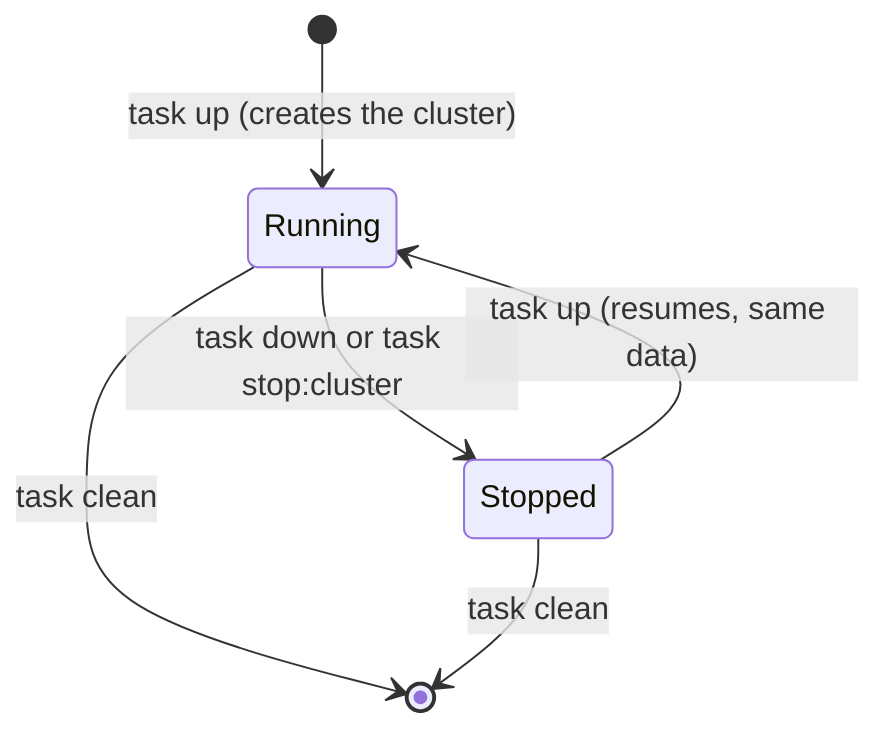

# Runbook

| Situation | Command |
| --- | --- |
| Check the Mac | `task doctor:prereqs` |
| Lint and secret scan | `task ci` (`task lint` for linters, policies and module tests only) |
| Start everything (and run doctor) | `task up` |
| Preview or apply Terraform changes | `task plan` / `task apply` |
| Full platform health check | `task doctor` (`task doctor -- --json` for JSON output; includes `task state:check`, which fails if Terraform state holds a secret value) |
| Stop, keep data | `task down` |
| Stop and start again | `task restart` |
| Stop only one part | `task stop:cluster` or `task stop:ollama` |
| See what runs & memory use | `task status` |
| UIs, secret names and API commands | `task access` (`task access -- --copy master` copies Admin UI password) |
| Check the cluster | `task smoke:cluster` (add `-- --lifecycle` to also test down and up) |
| Check PostgreSQL | `task smoke:postgres` |
| Check LiteLLM & models | `task smoke:litellm` |
| Check Temporal & sample workflow | `task smoke:temporal` |
| Look at the cluster | `task kube -- get pods -A` |
| Start from scratch | `task clean` then `task up` |
| Deep clean (cluster + caches + optional models) | `task clean:all` |

## Cluster lifecycle



- `task up` is safe to repeat. It creates the cluster from `cluster/k3d-config.yaml` the first time, resumes it later, rewrites the project kubeconfig `.kube/config`, and waits until the node, CoreDNS, Traefik on port 8080 and the pod route to Ollama are ready. A fresh cluster takes about 50 seconds; a resume about 90, most of it waiting for CoreDNS to pick up `host.k3d.internal`.
- `task down` stops the cluster and unloads Ollama models. Volumes stay, so databases survive.
- `task clean` asks first, then deletes the cluster, `.kube/config` and the local Terraform state. Every database is lost.
- Every script hashes your own kubeconfig before and after k3d runs and fails if it changed. k3d is configured never to write it.

## A step times out

Each wait names what it waited for and the command that shows why. The common ones:

| Message mentions | Look at |
| --- | --- |
| the API server or the node | `task kube -- describe nodes`; Docker Desktop must be running with its memory limit |
| Traefik or port 8080 | `task kube -- -n kube-system get pods`; another process on 8080 (`lsof -nP -iTCP:8080`) |
| host.k3d.internal | `task kube -- -n kube-system logs deployment/coredns`; run `task up` again, it waits again |
| an image pull (`ErrImagePull`, `image access restricted`) | Docker Desktop signed in to an organization: sign out (`task doctor:prereqs` warns on `docker-signin`); see [registry access](prerequisites.md#registry-access) |

## Ollama pulls fail

`proxyconnect ... connection refused` means Ollama kept a proxy from when it started. Run `task stop:ollama`, then `task up`. `task doctor:prereqs` warns on `ollama-proxy`.

## Web UIs and API access

| Service | URL | Authentication |
| --- | --- | --- |
| LiteLLM Admin UI | `http://litellm.localhost:8080/ui` | Username: `admin`, Password: the `masterkey` value in Secret `litellm-masterkey` |
| LiteLLM OpenAI-compatible API | `http://litellm.localhost:8080/v1` | `Authorization: Bearer <key>` using an agent virtual key (`litellm-<agent>-key`) or the master key |
| LiteLLM Swagger / OpenAPI docs | `http://litellm.localhost:8080/` | Master key or virtual key in the Swagger **Authorize** dialog |
| Temporal Web UI | `http://temporal.localhost:8080` (`http://temporal.localhost:8080/namespaces/default/workflows`) | None (open in local sandbox) |
| Temporal gRPC (Mac workers & CLI) | `localhost:7233` | None (cleartext gRPC in local sandbox) |

### Log in to the LiteLLM Admin UI (`http://litellm.localhost:8080/ui`)

Run `task access` to see all UIs, secret names and sample commands. Because secrets are never stored in files or Terraform state, copy the master key straight from the cluster Secret into your macOS clipboard (nothing is printed to the terminal):

```bash
task access -- --copy master
```

Then open `http://litellm.localhost:8080/ui` and sign in with:
- **Username:** `admin`
- **Password:** paste (`Cmd+V`)

### Call the LiteLLM API from your Mac

Each agent has its own scoped virtual key in Kubernetes (`litellm-pm-agent-key`, `litellm-dev-agent-key`, `litellm-sec-agent-key`). Copy an agent key to your clipboard and call `/v1/chat/completions`:

```bash
task access -- --copy pm-agent # or dev-agent, sec-agent

curl -sS --noproxy '*' http://litellm.localhost:8080/v1/chat/completions \
  -H "Authorization: Bearer $(pbpaste)" \
  -H "Content-Type: application/json" \
  -d '{
    "model": "pm-agent",
    "messages": [{"role": "user", "content": "Hello! Reply in one short sentence."}],
    "max_tokens": 128
  }' | jq -r '.choices[0].message.content'
```

### Open the Temporal Web UI and use the Temporal CLI from your Mac

The Temporal Web UI requires no login in the local sandbox:
- **Browser URL:** `http://temporal.localhost:8080/namespaces/default/workflows`
- **REST API:** `http://temporal.localhost:8080/api/v1/namespaces/default/workflows`
- **gRPC address for SDK workers and the `temporal` CLI on your Mac:** `localhost:7233`

Check cluster health, inspect the `default` namespace, and list workflows from your Mac:

```bash
temporal operator cluster health --address localhost:7233
temporal operator namespace describe --namespace default --address localhost:7233
temporal workflow list --address localhost:7233 --namespace default
```

Run `task smoke:temporal` at any time to start and complete a real workflow from your Mac and verify that it appears as `Completed` in the Web UI.

## Troubleshooting on this Mac

Check these before debugging from scratch.

- **Resume is slow on purpose.** After `task up` resumes a stopped cluster, pods cannot resolve `host.k3d.internal` for about 90 s. `cluster-setup.sh` waits for it; a fresh create takes about 50 s.
- **Ollama keeps the proxy it started with.** If it started while a proxy was set, `ollama pull` fails with `proxyconnect ... refused`. Fix: `task stop:ollama`, then `task up`. `task doctor:prereqs` warns.
- **A Docker Desktop sign-in can block images.** A work organization's registry rules refused `curlimages/curl` (`image access restricted`). Signing out lifts them; `task doctor:prereqs` warns while signed in. Probe pods use the official `busybox` image.
- **Docker Desktop's "system" proxy and the macOS PAC proxy are harmless.** In-cluster image pulls work through them.
- **Model sizes.** `gemma4:e4b` is 9.5 GB on disk (larger than its name suggests) and `gemma4:12b` 7.6 GB. Do not add models above about 10 GB while the cluster runs.
- **`gemma4` models use thinking tokens by default.** With `max_tokens: 16`, `gemma4:12b` and `gemma4:e4b` spend all 16 tokens in `thinking` and return an empty `content`. Completion probes should pass `max_tokens: 128` (or check `reasoning_content` / disable thinking).
- **Temporal chart SQL setup and host gRPC.** Because CloudNativePG creates `temporal` and `temporal_visibility` owned by the non-superuser `temporal` role with strict `pg_hba` isolation, both SQL datastores in `terraform/modules/temporal/values.yaml.tftpl` must set `createDatabase: false` so `temporal-sql-tool` skips connecting to the admin `postgres` DB. `server.frontend.service.type: LoadBalancer` exposes `temporal-frontend:7233` directly to `localhost:7233` on the Mac via k3s ServiceLB (`127.0.0.1:7233:7233` in `cluster/k3d-config.yaml`). Raw HTTP/2 gRPC calls to `localhost:7233` require a `grpc-timeout` header (e.g. `grpc-timeout: 15S`).
- **Setup Jobs expire via `ttlSecondsAfterFinished`.** LiteLLM's migration and virtual-key bootstrap Jobs (`ttlSecondsAfterFinished: 300` and `600`) and Temporal's schema and namespace setup Jobs (`schema.ttlSecondsAfterFinished: 86400`, 24h) are garbage-collected by Kubernetes once their TTL elapses. `scripts/terraform.sh` and `tests/smoke/temporal.sh` treat TTL-reaped Jobs as completed when the live service and `default` namespace are healthy, while still failing if any present Job fails or does not complete.

## A secret leaked

1. Revoke and rotate it first, at its source. A secret that reached a commit counts as public, even if the commit was never pushed.
2. Then remove it from git history and force-push, and tell anyone who cloned the repo.
3. Find out how it got past pre-commit, the hooks and CI, and close that gap.
